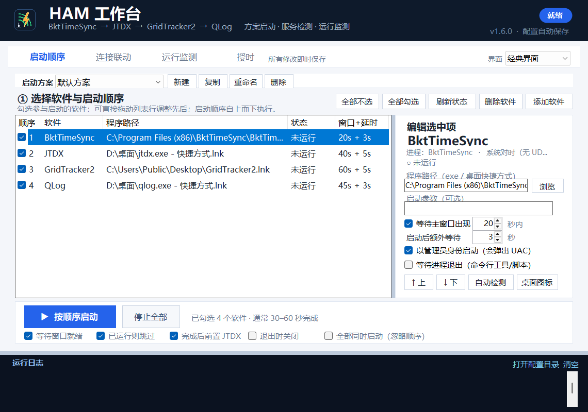
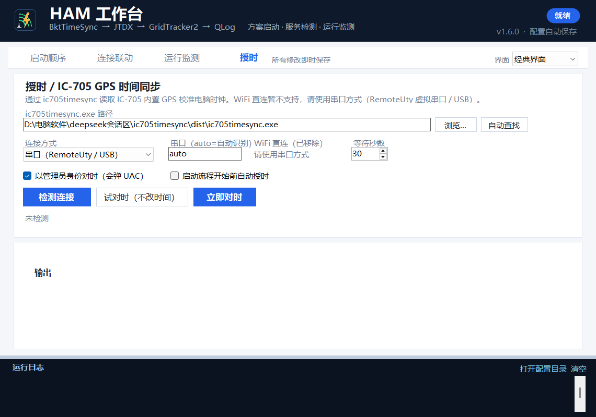

# HAM 工作台 · Ham Workbench

[](LICENSE)

一个面向业余无线电操作的中文 Windows 桌面工具。它把分散安装的 Ham 软件集中到一个工作台里：按方案顺序启动、自动发现运行中的软件、检测 UDP/TCP/串口连接和 ADI 日志文件，并提供多协议连接方案与运行状态告警。

> 旧名称：**HAM 启动台**。从 v1.3 起更名为 **HAM 工作台**；程序文件名仍保留 `HamStartup.exe`，以兼容旧快捷方式和已有配置。





## 功能

- **启动方案制**：多套方案独立保存；可添加 N1MM、JTDX、WSJT-X、GridTracker2、QLog、Log4OM、MSHV、JS8Call、fldigi 等任意 Ham 软件。
- **一键顺序启动 / 全部同时启动**：每个软件独立设置等待窗口时间、额外延时、管理员运行、已运行跳过。
- **等待进程退出（命令行工具）**：可把授时工具、脚本、批处理插进启动流程；按进程结束推进下一步并记录退出码。
  “全部同时启动”模式下带此选项的步骤也会先按顺序跑完，保证“先授时、后开 JTDX”。
- **IC-705 授时页**：顶部第四个标签页集中管理 `ic705timesync`：检测连接 / 试对时 / 立即对时，
  exe 路径自动查找，可勾选“启动流程开始前自动授时”。**WiFi 直连暂不支持，请用串口方式**
  （RemoteUty 虚拟串口或 USB）。
- **连接联动**：UDP、TCP、串口、自定义四类连接方案；自动匹配运行中的软件；DX Cluster 端口识别；参数可导出为 JSON。
- **运行监测**：自动发现当前运行的 Ham 软件，显示 PID、CPU、内存、UDP、DX 集群、ADI 记录文件。
- **卡死/崩溃提示**：窗口连续约 6 秒无响应、异常退出代码时，通过页面横幅、日志和托盘气泡提示。
- **三种界面**：经典界面（原 UI）、卡片、卡片 + 网络拓扑。
- **便携设置**：优先使用程序同目录的 `HamStartup.settings.ini`，不需要安装，不写注册表。
- **UDP 配置助手**：读取/备份/写入 JTDX、GridTracker2、QLog 的 UDP 联动配置。

## 下载

| 版本 | 程序 | 压缩包 | 说明 |
|---|---|---|---|
| **v1.6.0（当前）** | [HamStartup.exe](releases/v1.6.0/HamStartup.exe) | [HamStartup-v1.6.0.zip](releases/v1.6.0/HamStartup-v1.6.0.zip) | [使用说明](releases/v1.6.0/使用说明.md) |
| v1.3.1 | [HamStartup.exe](releases/v1.3.1/HamStartup.exe) | [HamStartup-v1.3.1.zip](releases/v1.3.1/HamStartup-v1.3.1.zip) | [使用说明](releases/v1.3.1/使用说明.md) |
| v1.3 | [HamStartup.exe](releases/v1.3/HamStartup.exe) | [HamStartup-v1.3.zip](releases/v1.3/HamStartup-v1.3.zip) | [使用说明](releases/v1.3/使用说明.md) |
| v1.2 | [HamStartup.exe](releases/v1.2/HamStartup.exe) | [HamStartup-v1.2.zip](releases/v1.2/HamStartup-v1.2.zip) | [使用说明](releases/v1.2/使用说明.md) |
| v1.1 | [HamStartup.exe](releases/v1.1/HamStartup.exe) | [HamStartup-v1.1.zip](releases/v1.1/HamStartup-v1.1.zip) | [使用说明](releases/v1.1/使用说明.md) |
| v1.0 | [HamStartup.exe](releases/v1.0/HamStartup.exe) | [HamStartup-v1.0.zip](releases/v1.0/HamStartup-v1.0.zip) | [使用说明](releases/v1.0/使用说明.md) |

各版本压缩包内均包含对应程序和使用说明。校验值见 [releases/SHA256SUMS.txt](releases/SHA256SUMS.txt)。

系统要求：Windows 10 / 11 64 位，.NET Framework 4.8（系统自带），无需 Python / Node.js。程序未做数字签名，SmartScreen 提示时选择“更多信息 → 仍要运行”。

v1.6.0 为本地整合发行版：合并 2026-11-07 夜间 1.4 / 1.5 / 1.5.1 / 1.5.2 测试版的全部功能与修复。

## 发行作品（GitHub Releases）

每个历史版本都已创建独立的 GitHub Release，包含 `HamStartup-vX.Y.exe`、`HamStartup-vX.Y.zip`、`Instructions-vX.Y.md` 和 `SHA256SUMS-vX.Y.txt`：

| 版本 | 发行作品 | 主要内容 |
|---|---|---|
| **v1.6.0（本地构建）** | 尚未上传 | 整合 1.4→1.5.2 测试版、授时页、等待进程退出、`--help/--version` |
| v1.3.1 | [v1.3.1 Release](https://github.com/BH3XZT/HAM-/releases/tag/v1.3.1) | 消除相关测试 bug、可拖拽调整、停止全部修复 |
| v1.3 | [v1.3 Release](https://github.com/BH3XZT/HAM-/releases/tag/v1.3) | HAM 工作台、连接联动、三种 UI |
| v1.2 | [v1.2 Release](https://github.com/BH3XZT/HAM-/releases/tag/v1.2) | 方案制、运行监测、服务检测 |
| v1.1 | [v1.1 Release](https://github.com/BH3XZT/HAM-/releases/tag/v1.1) | 便携设置、快捷方式、QLog 修复 |
| v1.0 | [v1.0 Release](https://github.com/BH3XZT/HAM-/releases/tag/v1.0) | 初始版本、顺序启动、UDP 联动 |

## 快速开始

1. 下载并解压 `HamStartup-v1.6.0.zip`，双击 `HamStartup.exe`。
2. 在“启动方案”里选择方案，点“添加软件”选择本机已安装的 Ham 程序。
3. 勾选软件、调整顺序；需要同时启动时勾选“全部同时启动（忽略顺序）”。
4. 点启动，完成后在“运行监测”页查看软件状态、UDP/DX/ADI 和自动匹配的连接方案。
5. 在“连接联动”页编辑或下载连接参数。
6. 需要给 IC-705 授时，切到顶部“授时”页（见下一节）。

## 接入 IC-705 授时（可选）

户外用 IC-705 热点 + RemoteUty 跑 FT8 时，系统时间必须准。v1.6.0 提供两种方式：

> **重要：WiFi 直连暂不支持。** 独立版 `ic705timesync.exe` 无法加载 `icom-lan` 模块，
> 连接方式只保留**串口**（RemoteUty 虚拟串口或 USB 直连）；旧配置里的 `transport=lan`
> 会自动按串口处理。

### 方式 A：授时页（推荐）

顶部 **“授时”** 标签页集中管理：

1. 指定 `ic705timesync.exe` 路径（支持“浏览…”和“自动查找”）；
2. 连接方式固定为“串口（RemoteUty / USB）”，串口填 `auto` 或具体 `COM20`；
3. 点 **检测连接** 看 GPS 与电脑时钟偏差；点 **试对时** 只算不写；点 **立即对时** 真正校准（会弹 UAC）；
4. 勾选 **“启动流程开始前自动授时”**，以后每次启动（按顺序或全部同时启动）都会先对时再开软件。

### 方式 B：把授时作为启动流程中的一步

1. 把 `ic705timesync.exe` 放到固定目录（例如 `D:\电台软件\ic705timesync\`）。
2. 启动顺序页 → 添加软件 → 选择 `ic705timesync.exe`，启动参数填 `sync --port auto`。
3. 勾选 **等待进程退出（命令行工具/脚本）** 和 **以管理员身份启动**，等待秒数填 `30`。
4. 把它拖到 **RemoteUty 之后、JTDX 之前**；启动流程会先对时再开 JTDX。
   （即使勾了“全部同时启动”，带“等待进程退出”的步骤也会先按顺序跑完。）

> 为什么顺序很重要：RemoteUty 的虚拟串口是独占的，JTDX 打开后就无法再对时；
> 而且授时必须等 RemoteUty 建立会话、虚拟串口可用之后才能执行。

## 命令行

```text
HamStartup.exe --help              显示帮助（也可用 -h / -?）
HamStartup.exe --version           显示版本号（也可用 -v）
HamStartup.exe --autostart         打开后自动开始启动
HamStartup.exe --quit-after-start  启动流程结束后退出
HamStartup.exe --config <路径>     使用指定 settings.ini
```

从命令行启动时信息输出到控制台；双击启动时用弹窗显示。

## 从源码构建

只需要 Windows 自带的 .NET Framework 4.x C# 编译器，不需要 Visual Studio / .NET SDK：

```powershell
git clone https://github.com/BH3XZT/HAM-.git
cd HAM-
powershell -NoProfile -ExecutionPolicy Bypass -File .\build.ps1
# 输出：dist\HamStartup.exe
```

源码位于 `src/`，资源与清单位于 `assets/`、`app.manifest`。

## 目录结构

```text
src/                 v1.6.0 C# 源码（WinForms / .NET Framework 4.8）
assets/              图标与内嵌资源
build.ps1            csc.exe 构建脚本
app.manifest         Windows 清单
releases/v1.0-v1.6.0/ 各版本 exe、zip、使用说明、截图
legacy/v1.0-source/  v1.0 历史源码
docs/                界面截图
```

## 版本历史

- **v1.6.0**：整合 1.4 / 1.5 / 1.5.1 / 1.5.2 夜间测试版；新增“等待进程退出”和“授时”页；
  移除 WiFi 直连、统一串口方式；修复授时页布局与失败提示；新增 `--help/--version`。
- **v1.3.1**：消除相关测试 bug；修复“停止全部”不关闭软件；增加三处分隔条拖拽调整和列表/卡片拖动排序。
- **v1.3**：更名 HAM 工作台；连接联动支持 UDP/TCP/串口/自定义、自动匹配、参数下载；新增经典/卡片/卡片+拓扑三种 UI。
- **v1.2**：启动方案制；启动后自动检测 UDP/DX/ADI；新增运行监测页、卡死/崩溃提示。
- **v1.1**：便携设置；支持桌面 `.lnk` 快捷方式；低完整性权限提示；QLog 配置问题修复。
- **v1.0**：初始版本，顺序启动与 UDP 联动配置。

详见 [CHANGELOG.md](CHANGELOG.md)。

## 隐私与安全

- 程序不联网、不上传数据。
- 仓库不包含任何用户的 `HamStartup.settings.ini`、运行日志、UDP 配置备份或通联数据库。
- UDP 配置写入前自动备份；QLog 备份可能包含通联日志，请勿公开分享备份目录。
- 本工具会读取本机进程、端口和指定软件的配置文件，用于启动和监测；不会修改无关设置。

## 许可证

本项目使用 [MIT License](LICENSE)。

## 致谢 / 免责声明

本项目是个人业余无线电工具，与 BktTimeSync、JTDX、WSJT-X、GridTracker2、QLog、N1MM 等软件的作者/组织无隶属关系。使用本工具修改软件配置前请自行备份；因配置变更或软件升级造成的问题由使用者自行承担。
