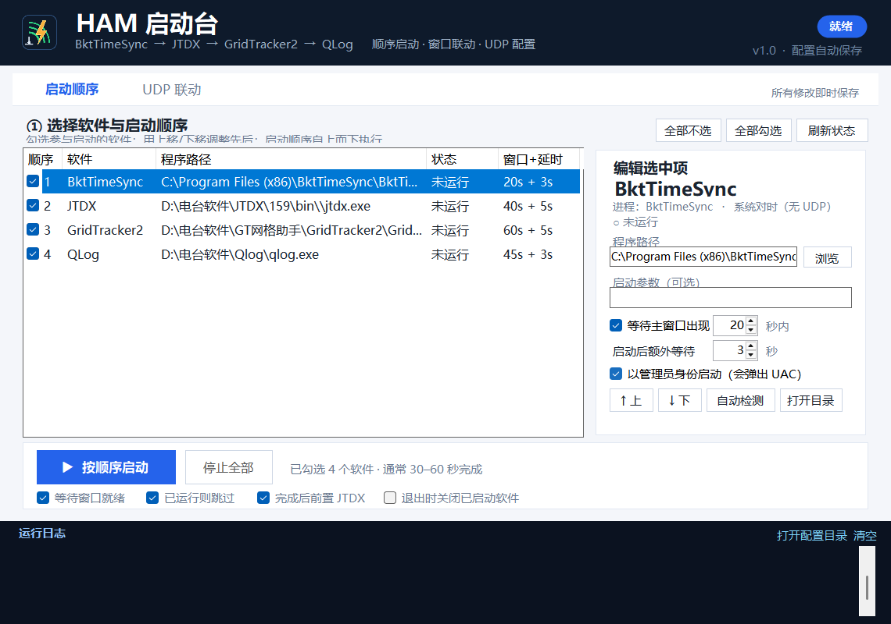
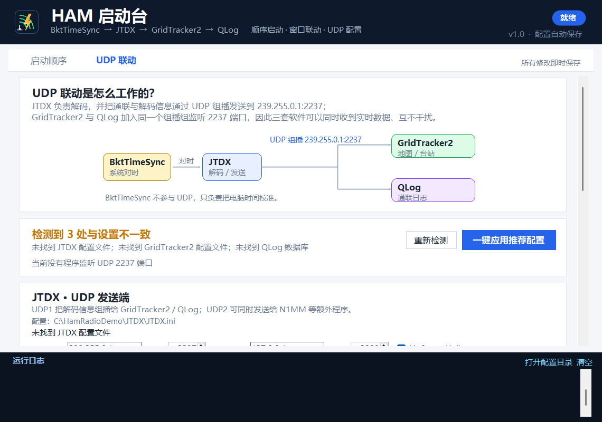

# HAM 启动台 · 使用说明（v1.0）

一个中文 Windows 小程序：把 **BktTimeSync、JTDX、GridTracker2、QLog** 按你设定的顺序一键启动，并检查和写入三套软件的 UDP 联动配置。





---

## 一、30 秒上手

1. 双击 `HamStartup.exe`。
2. 程序会自动检测四款软件；如果有“未检测到”，选中该项点 **自动检测**，或点 **浏览** 指定 exe。
3. 勾选要参与启动的软件，用 **↑ 上移 / ↓ 下移** 调整顺序。
4. 点 **▶ 按顺序启动**。

默认顺序：

```text
BktTimeSync → JTDX → GridTracker2 → QLog
```

启动全部完成后，默认会把 **JTDX 窗口切到最前**（对应“最后再回到 JTDX”）。JTDX 是单实例程序，不会也不应该重复启动两次；如果你不需要前置 JTDX，取消底部“完成后前置 JTDX”即可。

> 程序未做数字签名。若 SmartScreen 提示“已保护你的电脑”，点“更多信息 → 仍要运行”。

---

## 二、启动顺序页

每个软件一行，勾选框决定是否参与启动：

- **顺序**：从上到下执行；用右侧“↑ 上移 / ↓ 下移”调整。
- **程序路径**：可自动检测、浏览选择；路径无效时该行会变红提示。
- **窗口+延时**：例如 `20s + 3s` = 最多等主窗口 20 秒，窗口出现后再额外等 3 秒，才启动下一个。
- **状态**：实时显示“运行中 / 未运行”。

右侧“编辑选中项”可设置：

| 选项 | 说明 |
|---|---|
| 启动参数 | 一般留空 |
| 等待主窗口出现 | 推荐开启；避免上一个软件还没起来就启动下一个 |
| 启动后额外等待 | 给解码器/地图加载留时间 |
| 以管理员身份启动 | BktTimeSync 默认开启（校时需要管理员权限，会弹 UAC） |

底部联动选项：

- **等待窗口就绪**：总开关；关闭后只按“额外等待”计时。
- **已运行则跳过**：默认开启，避免 JTDX 第二实例抢占声卡。
- **完成后前置 JTDX**：启动完成后把 JTDX 切到前台。
- **退出时关闭已启动软件**：关闭启动器时一并关闭本次由它启动的程序（不影响原本就在运行的实例）。

**停止全部**：只关闭本次由启动器启动的进程，会先弹确认框。

---

## 三、UDP 联动页

### 1. 数据流

```text
BktTimeSync（只校时，无 UDP）
        │
        ▼
      JTDX  ──UDP 组播 239.255.0.1:2237──▶  GridTracker2（地图/台站）
        │                                └▶  QLog（通联日志）
        └──UDP2 127.0.0.1:2333──▶  N1MM 等额外程序（可选）
```

- JTDX 是 UDP **发送端**；GridTracker2 与 QLog 都加入 `239.255.0.1:2237` 组播组监听，所以能同时收到数据。
- 单播 `127.0.0.1:2237` 只能被一个程序独占，因此推荐组播。

### 2. 推荐值

| 软件 | 配置位置 | 推荐值 |
|---|---|---|
| JTDX | `%LOCALAPPDATA%\JTDX\JTDX.ini` → `[Configuration]` | UDP1 `239.255.0.1:2237`；UDP2 `127.0.0.1:2333`；`AcceptUDPRequests=true` |
| GridTracker2 | `%APPDATA%\GridTracker2\Ginternal\app-settings.json` | `wsjtIP=239.255.0.1`、`wsjtUdpPort=2237`、`multicast=true` |
| QLog | `%LOCALAPPDATA%\hamradio\QLog\qlog.db` | 监听 `2237`、组播地址 `239.255.0.1`、加入组播、TTL 1、转发 `127.0.0.1` |

### 3. 读取与写入

- **读取当前**：把该软件现有配置填到表单（不写入）。
- **应用 XXX 设置**：把表单值写回该软件。
- **一键应用推荐配置**：依次写 JTDX、GridTracker2、QLog。

写入规则：

1. **先关闭对应软件**（JTDX / GridTracker2 / QLog）。软件运行时会锁定或退出时覆盖配置。
2. 写入前自动备份到：
   `%APPDATA%\HamStartup\backups\yyyyMMdd_HHmmss\`
   包含 `JTDX.ini`、`app-settings.json`、`qlog.db`（约 58 MB，备份需要几秒）。
3. 写入后自动回读校验；失败会报错并保留备份。

> `qlog.db` 备份可能包含通联日志/账号相关字段，请勿随意分享备份目录；程序不会自动删除旧备份。

### 4. 启动前检查

UDP 页底部的 **“启动前检查 UDP 配置”** 勾选后，点“按顺序启动”会先对比当前配置与推荐值；不一致会提示，但不会强制阻止启动。

---

## 四、文件位置

| 内容 | 路径 |
|---|---|
| 启动器设置 | `%APPDATA%\HamStartup\settings.ini` |
| 运行日志 | `%APPDATA%\HamStartup\logs\launcher-yyyyMMdd.log` |
| 配置备份 | `%APPDATA%\HamStartup\backups\时间戳\` |
| 程序本体 | 任意位置，单文件 `HamStartup.exe` |

日志文件每行带 `[INFO]/[STEP]/[OK]/[WARN]/[ERR]` 级别前缀，便于检索。

---

## 五、命令行（可选）

```text
HamStartup.exe                     正常打开界面
HamStartup.exe --autostart         打开后自动开始顺序启动
HamStartup.exe --quit-after-start  启动流程结束后自动退出
HamStartup.exe --config <路径>     使用指定 settings.ini
```

例：把快捷方式放进“启动”文件夹，目标写：

```text
"D:\工具\HamStartup\HamStartup.exe" --autostart
```

---

## 六、常见问题

**1. 收不到数据 / GridTracker2 没有台站？**
- UDP 页确认显示“UDP 配置一致”。
- 三套软件必须是同一个组播地址和端口（推荐 `239.255.0.1:2237`）。
- 首次运行在 Windows 防火墙中允许 `jtdx.exe`、`GridTracker2.exe`、`qlog.exe` 的 UDP 入站。
- 修改配置后重启三套软件。

**2. JTDX 没有出现？**
看日志是否“已在运行，跳过启动”。JTDX 只允许一个实例；它可能已在后台。

**3. BktTimeSync 弹 UAC？**
校时需要管理员权限。可在启动顺序页取消“以管理员身份启动”；更推荐让 BktTimeSync 用计划任务在登录后自行对时，启动器里不勾选它。

**4. QLog 应用失败？**
先完全退出 QLog（含托盘），确认 `qlog.db` 没有被杀毒/同步盘锁定，再重试。程序写入前会备份，失败不会破坏原数据库。

**5. 非法 exe / 文件损坏？**
程序会先校验 PE 头，快速报“不是有效的 Windows 可执行文件”，不会卡住界面。

**6. 设置无法保存？**
检查 `%APPDATA%\HamStartup` 是否可写；被杀毒软件拦截时日志会提示。

---

## 七、安全说明

- 只修改上面列出的 UDP 配置键；JTDX.ini 其余键、GridTracker2 JSON 其他字段原样保留。
- QLog 用 SQLite 事务只更新 `log_param` 的 5 个键，写前复制整个数据库。
- 不联网、不收集上传任何数据。
- 所有写入都有时间戳备份；如出问题，可从备份目录手动恢复。

---

## 八、运行环境与版本

- Windows 10 / 11 64 位；.NET Framework 4.8（系统自带）。
- 单文件 exe，约 164 KB，无需 Python / Node.js。
- v1.0，2026-11-01。
