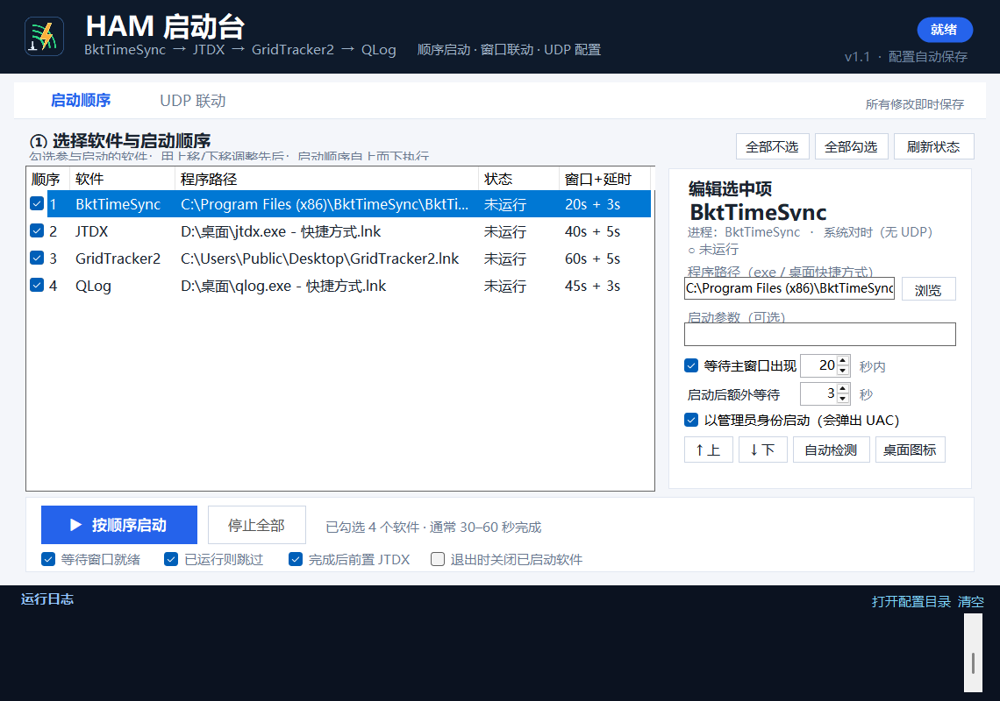
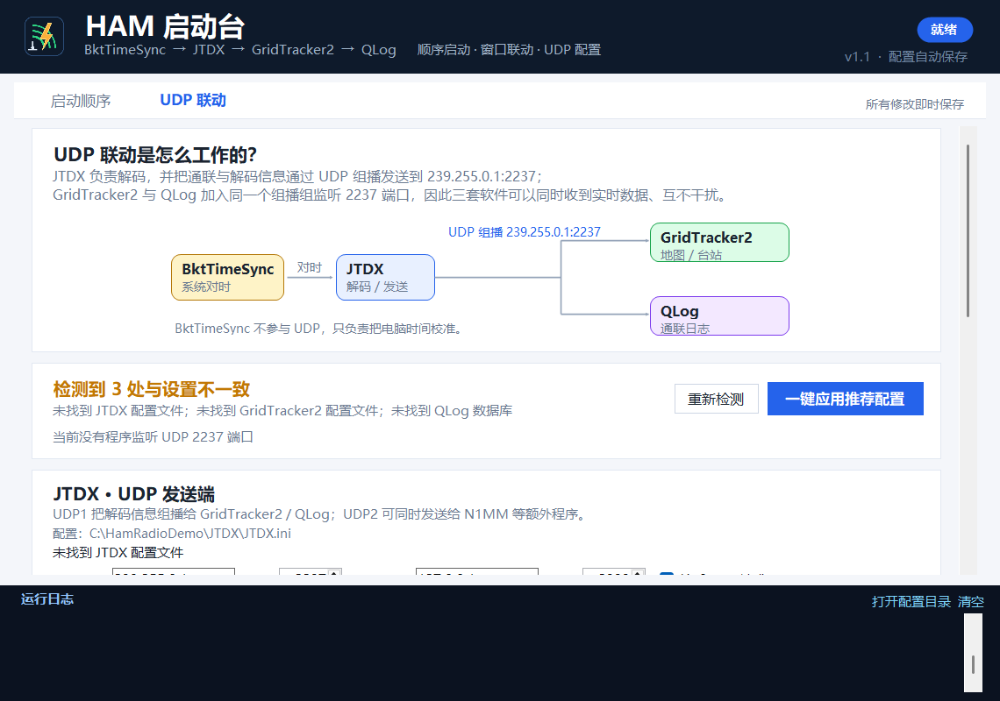

# HAM 启动台 · 使用说明（v1.1）

一个中文 Windows 小程序：把 **BktTimeSync、JTDX、GridTracker2、QLog** 按你设定的顺序一键启动，并检查和写入三套软件的 UDP 联动配置。





---

## 一、这次修了什么

### 1. 设置保存失败（AppData 访问被拒绝）

v1.1 改为**便携设置**：

- 默认优先把设置保存在 `HamStartup.exe` 同目录的 `HamStartup.settings.ini`；
- 如果检测到可写的旧 AppData 设置（`%APPDATA%\HamStartup\settings.ini`），会继续沿用它以保留原配置；
- 如果程序目录和 AppData 都不可写，再回退到 `%LOCALAPPDATA%\HamStartup\settings.ini`，最后才用系统临时目录；
- 日志和 UDP 配置备份也跟随设置文件所在目录。

因此即使 `%APPDATA%` 被策略/沙箱/杀毒软件限制，程序仍能保存设置。

### 2. QLog 启动后“所有设置全没了”

v1.1 支持**直接选用桌面图标（.lnk）**：

- 启动顺序页选中软件后，点 **桌面图标** 按钮，程序会找到对应桌面快捷方式；
- 点 **自动检测** 时也会优先使用桌面图标；
- 启动时使用快捷方式的目标 exe、**参数**和**起始目录**，与双击桌面图标一致；
- 快捷方式的“起始位置”对 QLog 这类程序很重要。

另外，v1.1 会检测**受限权限（低完整性）运行环境**：

- 如果程序被 AI 沙箱/低权限环境启动，会弹出提示，建议“以管理员身份重新启动”；
- 在这种环境下，QLog 可能无法读取 `%LOCALAPPDATA%\hamradio\QLog`，从而显示全新配置；
- 最稳妥的方式：关闭程序，在**资源管理器里正常双击** `HamStartup.exe`，或接受提示以管理员身份重启。

如果日志里仍出现：

```text
警告：QLog 数据目录不可写（C:\Users\...\AppData\Local\hamradio\QLog）
```

请检查该目录权限、杀毒软件，或先手动正常启动一次 QLog；也可以点击“桌面图标”改用快捷方式启动。

---

## 二、30 秒上手

1. 双击 `HamStartup.exe`。
2. 程序会自动检测四款软件；有“未检测到”时，选中该项点 **自动检测**、**桌面图标** 或 **浏览**。
3. 勾选要参与启动的软件，用 **↑ 上移 / ↓ 下移** 调整顺序。
4. 点 **▶ 按顺序启动**。

默认顺序：

```text
BktTimeSync → JTDX → GridTracker2 → QLog
```

全部启动完成后，默认把 **JTDX 窗口切到最前**（对应“最后再回到 JTDX”）。JTDX 是单实例程序，不会重复启动；不需要前置时取消底部“完成后前置 JTDX”。

> 程序未签名。若 SmartScreen 提示“已保护你的电脑”，点“更多信息 → 仍要运行”。

---

## 三、启动顺序页

每个软件一行，勾选框决定是否参与启动：

- **顺序**：自上而下执行；用“↑ 上移 / ↓ 下移”调整。
- **程序路径**：可以是 `.exe` 或桌面 `.lnk` 快捷方式；路径无效时该行变红。
- **窗口+延时**：例如 `20s + 3s` = 最多等主窗口 20 秒，窗口出现后再额外等 3 秒才启动下一个。
- **状态**：实时显示“运行中 / 未运行”。

右侧“编辑选中项”：

| 选项 | 说明 |
|---|---|
| 程序路径 | 可直接编辑；支持 exe / .lnk |
| 浏览 | 文件对话框已支持选择快捷方式 |
| 桌面图标 | 自动查找该软件的桌面 .lnk 并填入 |
| 自动检测 | 优先找桌面图标，找不到再找 exe |
| 启动参数 | 一般留空；快捷方式自身的参数会保留 |
| 等待主窗口出现 | 推荐开启 |
| 启动后额外等待 | 给解码器/地图加载留时间 |
| 以管理员身份启动 | BktTimeSync 默认开启（会弹 UAC） |

底部联动选项：

- 等待窗口就绪
- 已运行则跳过（避免 JTDX 第二实例抢声卡）
- 完成后前置 JTDX
- 退出时关闭已启动软件（只关本次启动的实例）

**停止全部**：只关闭本次由启动器启动的进程，会先确认。

---

## 四、UDP 联动页

### 数据流

```text
BktTimeSync（只校时，无 UDP）
        │
        ▼
      JTDX  ──UDP 组播 239.255.0.1:2237──▶  GridTracker2（地图/台站）
        │                                └▶  QLog（通联日志）
        └──UDP2 127.0.0.1:2333──▶  N1MM 等额外程序（可选）
```

- JTDX 是 UDP 发送端；GridTracker2 与 QLog 都加入 `239.255.0.1:2237` 组播组监听。
- 单播 `127.0.0.1:2237` 只能被一个程序独占，所以推荐组播。

### 推荐值

| 软件 | 配置位置 | 推荐值 |
|---|---|---|
| JTDX | `%LOCALAPPDATA%\JTDX\JTDX.ini` | UDP1 `239.255.0.1:2237`；UDP2 `127.0.0.1:2333`；接受 UDP 请求 |
| GridTracker2 | `%APPDATA%\GridTracker2\Ginternal\app-settings.json` | `wsjtIP=239.255.0.1`、`wsjtUdpPort=2237`、`multicast=true` |
| QLog | `%LOCALAPPDATA%\hamradio\QLog\qlog.db` | 监听 `2237`、组播 `239.255.0.1`、加入组播、TTL 1、转发 `127.0.0.1` |

### 读取与写入

- **读取当前**：把该软件现有配置填到表单（不写入）。
- **应用 XXX 设置**：写回该软件。
- **一键应用推荐配置**：依次写 JTDX、GridTracker2、QLog。

写入前必须**先关闭对应软件**；程序会自动备份到设置目录下的 `backups\时间戳\`，包括 `JTDX.ini`、`app-settings.json`、`qlog.db`（约 58 MB）。写入后自动回读校验。

> 备份中的 `qlog.db` 可能包含通联日志/账号字段，请勿随意分享备份目录。

---

## 五、文件位置

v1.1 优先使用**便携模式**（保留可写的旧 AppData 设置时除外）：

| 内容 | 位置 |
|---|---|
| 设置 | `HamStartup.exe` 同目录的 `HamStartup.settings.ini`（或沿用可写的旧 AppData） |
| 日志 | 设置文件同目录 `logs\launcher-yyyyMMdd.log` |
| 备份 | 设置文件同目录 `backups\时间戳\` |

如果程序目录不可写，则自动回退到 `%APPDATA%\HamStartup\`、`%LOCALAPPDATA%\HamStartup\` 或系统临时目录；启动日志会显示实际路径。

日志每行带 `[INFO]/[STEP]/[OK]/[WARN]/[ERR]` 级别前缀。

---

## 六、命令行（可选）

```text
HamStartup.exe                     正常打开
HamStartup.exe --autostart         打开后自动开始顺序启动
HamStartup.exe --quit-after-start  启动流程结束后退出
HamStartup.exe --config <路径>     使用指定 settings.ini
```

例：快捷方式目标写：

```text
"D:\工具\HamStartup\HamStartup.exe" --autostart
```

---

## 七、常见问题

**1. 设置保存失败 / AppData 访问被拒绝？**
v1.1 已改为便携设置，一般不会再出现。若仍出现，请把 `HamStartup.exe` 放到有写权限的目录（不要放 `C:\Program Files`），或查看日志中的实际设置路径。

**2. QLog 还是显示全新配置？**
- 先完全退出 QLog 和启动器。
- 启动顺序页选中 QLog → 点 **桌面图标**，确认路径变为 `...qlog.exe - 快捷方式.lnk`。
- 如果启动时提示“受限权限”，选“是”以管理员重启；或从资源管理器正常双击 exe。
- 看日志是否仍有“QLog 数据目录不可写”；如有，检查 `%LOCALAPPDATA%\hamradio\QLog` 权限/杀毒软件。

**3. 收不到数据 / GridTracker2 没有台站？**
- UDP 页确认“UDP 配置一致”。
- 三套软件使用同一组播地址端口（推荐 `239.255.0.1:2237`）。
- 首次运行在 Windows 防火墙允许 jtdx / GridTracker2 / qlog 的 UDP 入站。
- 修改配置后重启三套软件。

**4. JTDX 没有出现？**
看日志是否“已在运行，跳过启动”。JTDX 只允许一个实例。

**5. BktTimeSync 弹 UAC？**
校时需要管理员权限。可取消“以管理员身份启动”，或让 BktTimeSync 用计划任务自行对时并取消勾选。

**6. 快捷方式没有“以管理员身份运行”标记怎么办？**
程序会保留快捷方式的目标、参数、起始目录，但不会复制快捷方式属性里的管理员标记；需要时请勾选该软件的“以管理员身份启动”。

---

## 八、安全说明

- 只修改上面列出的 UDP 配置键；JTDX.ini 其余键、GridTracker2 JSON 其他字段原样保留。
- QLog 用 SQLite 事务只更新 `log_param` 的 5 个键，写前复制整个数据库。
- 不联网、不收集上传任何数据。
- 所有写入都有时间戳备份，可从备份目录手动恢复。

---

## 九、运行环境与版本

- Windows 10 / 11 64 位；.NET Framework 4.8（系统自带）。
- 单文件 exe，约 173 KB，无需 Python / Node.js。
- v1.1，2026-11-01。
