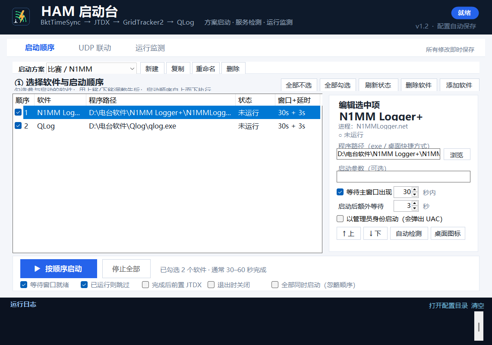
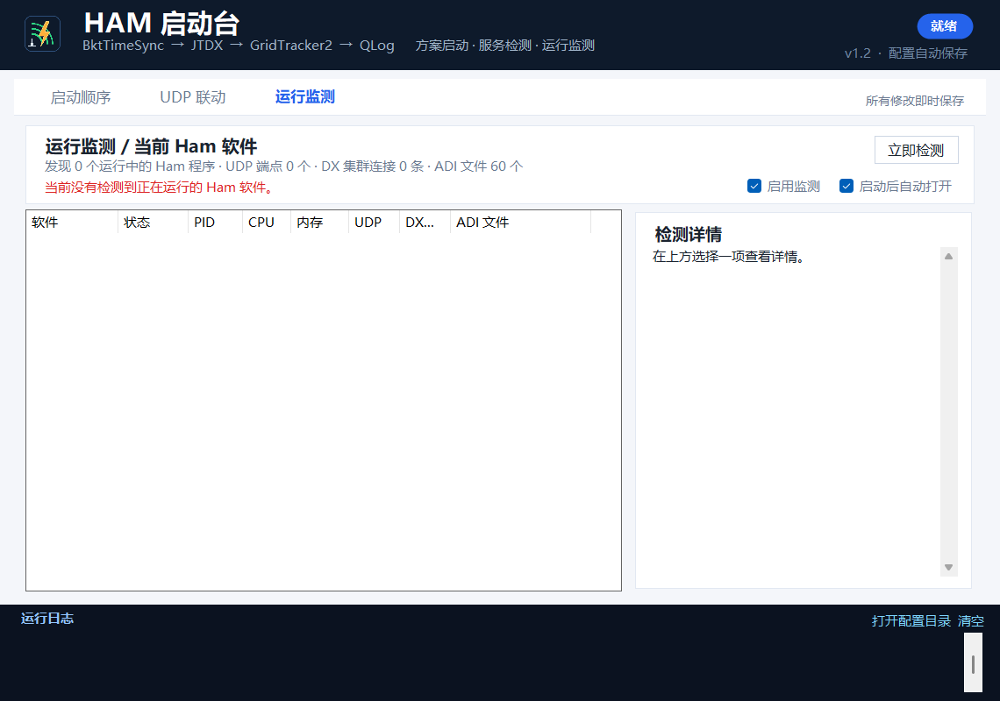

# HAM 启动台 · 使用说明（v1.2）

一个中文 Windows 小程序：用**方案**管理任意 Ham 软件的启动顺序，一键启动后自动检测 UDP / DX 集群 / ADI 记录文件，并在“运行监测”页显示当前 Ham 软件状态、卡死与崩溃提示。





---

## 一、v1.2 新增功能

### 1. 启动方案制

- 顶部“启动方案”下拉框可在多套方案之间切换；
- **新建**：创建空方案；**复制**：复制当前方案；**重命名** / **删除**；
- **添加软件**：列出注册表和开始菜单中检测到的 Ham 软件（N1MM、JTDX、WSJT-X、GridTracker2、QLog、Log4OM、MSHV、JS8Call、fldigi、SDR 软件等），也可以浏览任意 `.exe` / 桌面 `.lnk`；
- **删除软件**：只从方案移除，不卸载软件；
- 每套方案独立保存勾选、顺序、等待时间、管理员运行等设置。

已有 v1.0/v1.1 的四软件配置会自动迁移到“默认方案”，不会丢失。

### 2. 启动后自动服务检测

启动流程结束（顺序启动或“全部同时启动”）后自动执行检测，并显示在“运行监测”页：

- **UDP 服务**：按进程列出本地 UDP 端点端口（如 JTDX/GridTracker2/QLog 的 2237、JTDX UDP2 2333 等）；
- **DX 集群**：列出该软件的 TCP 连接，远端端口 7300/7301/7373/8000/23/7000/41112 等标记为“疑似 DX 集群”；
- **ADI 记录文件**：扫描常见目录，匹配到各软件的 `.adi` / `.adif` 文件，显示完整路径、大小、修改时间。

检测范围：本机 UDP/TCP 端点、当前活动 TCP 连接、以及 Documents / 桌面 / 下载 / JTDX / WSJT-X / N1MM / 各方案程序目录等常见位置的 ADI 文件。首次扫描可能需要几秒，之后每 3 秒刷新运行状态，ADI 列表每 15 秒更新。

### 3. 运行监测页

- 自动发现当前正在运行的 Ham 软件（不要求先在方案中配置），显示：软件、状态、PID、CPU、内存、UDP 端口、DX 集群连接数、ADI 文件；
- 选中软件后，右侧显示完整信息：路径、窗口标题、启动时间、UDP 端点、TCP 连接、ADI 文件列表；
- **卡死检测**：有窗口的软件连续约 6 秒不响应，标记“无响应，可能卡死”，页面顶部红色提示、写日志并弹托盘气泡；
- **崩溃检测**：软件异常退出（退出代码非 0）或退出前长时间无响应，提示“可能已崩溃”；
- 正常关闭（退出代码 0）不会误报；
- “启用监测”可关闭轮询；“启动后自动打开”控制启动后是否自动切到本页；
- 点“立即检测”可马上刷新。

---

## 二、快速上手

1. 双击 `HamStartup.exe`。
2. 在“启动方案”处选择方案；新方案点 **添加软件**。
3. 勾选要启动的软件，用 **↑ 上移 / ↓ 下移** 调整顺序。
4. 点 **▶ 按顺序启动**；如果勾选底部 **全部同时启动（忽略顺序）**，按钮会变成“全部同时启动”。
5. 启动结束后，若勾选“启动后自动打开”，会自动进入“运行监测”页，显示 UDP、DX 集群、ADI 与软件状态。

---

## 三、启动顺序页

### 方案栏

| 按钮 | 作用 |
|---|---|
| 启动方案 | 切换方案 |
| 新建 | 创建空方案 |
| 复制 | 复制当前方案 |
| 重命名 | 修改方案名 |
| 删除 | 删除当前方案（至少保留一个） |

### 软件列表

- **勾选框**：是否参与启动。
- **顺序**：从上到下；用“↑ 上移 / ↓ 下移”调整。
- **程序路径**：`.exe` 或 `.lnk`；路径无效会变红。
- **窗口+延时**：例如 `20s + 3s` = 最多等主窗口 20 秒，窗口出现后再等 3 秒。
- **状态**：运行中 / 未运行。

右侧“编辑选中项”可设置路径、启动参数、等待时间、额外延时、管理员运行、桌面图标、自动检测等。

底部选项：

- 等待窗口就绪
- 已运行则跳过
- 完成后前置 JTDX
- 退出时关闭
- **全部同时启动（忽略顺序）**

### 添加软件

点“添加软件”会打开选择窗口：

- 上半部分是自动检测到的 Ham 软件，双击即可填入；
- 也可以点“浏览…”选择任意 `.exe` 或 `.lnk`；
- 填写软件名称后点“添加到方案”。

这样 N1MM、Log4OM、MSHV、JS8Call 等都可以和原有四款软件自由混排。

---

## 四、运行监测页

顶部摘要：

```text
发现 N 个运行中的 Ham 程序 · UDP 端点 N 个 · DX 集群连接 N 条 · ADI 文件 N 个
```

列表列：

- 软件 / 状态 / PID / CPU / 内存 / UDP / DX集群 / ADI 文件；
- “未启动”的当前方案软件也会列出，便于确认；
- 卡死软件状态显示“无响应”，异常退出会出现在顶部提示中。

右侧详情：

- 进程路径、窗口标题、启动时间；
- UDP 服务：地址与端口；
- TCP / DX 集群：本地→远端、状态、[疑似 DX 集群]；
- ADI 记录文件：完整路径、大小、修改时间（找不到匹配时列出最近检测到的 ADI 文件）。

### 卡死 / 崩溃提示

- 卡死：窗口存在但连续约 6 秒 `Responding=false`；
- 崩溃：进程消失且退出代码非 0，或退出前处于无响应状态；
- 提示方式：页面顶部红色横幅 + 运行日志 `[WARN]` + 系统托盘气泡；
- 点“停止全部”关闭本次启动的软件时，会暂时静音告警，避免误报。

---

## 五、UDP 联动页（保留）

- JTDX / GridTracker2 / QLog 的 UDP 配置读取、推荐值、一键应用；
- 写入前自动备份；
- “启动前检查 UDP 配置”；
- 数据流与端口说明与 v1.1 相同。

推荐值：JTDX `239.255.0.1:2237`（UDP1）/ `127.0.0.1:2333`（UDP2）；GridTracker2 `239.255.0.1:2237` 组播；QLog 监听 `2237` 组播。

写入前请关闭对应软件；备份在设置文件同目录的 `backups\时间戳\`。

---

## 六、设置与便携模式

- 优先使用 exe 同目录的 `HamStartup.settings.ini`；
- 如果检测到可写的旧 AppData 设置，会继续沿用；
- 程序目录和 AppData 都不可写时，回退到 `%LOCALAPPDATA%` 或系统临时目录；
- 日志、UDP 备份跟随设置文件位置；
- 日志每行带 `[INFO]/[STEP]/[OK]/[WARN]/[ERR]` 前缀。

如果程序运行在受限权限（低完整性/AI 沙箱）环境，启动时会提示“以管理员身份重新启动”；否则 QLog 等软件可能读不到自己的配置而显示全新配置。

---

## 七、命令行

```text
HamStartup.exe                     正常打开
HamStartup.exe --autostart         打开后自动开始启动
HamStartup.exe --quit-after-start  启动流程结束后退出
HamStartup.exe --config <路径>     使用指定 settings.ini
```

---

## 八、常见问题

**1. 方案里添加了 N1MM，但没有按顺序启动？**
确认该行勾选；如果勾选“全部同时启动”，所有软件会同时启动、忽略顺序。

**2. 运行监测里看不到某个软件？**
- 它可能不在已知 Ham 软件名单中，且未加入当前方案；
- 先加入方案，或确认进程名包含常见 Ham 关键词；
- 点“立即检测”。

**3. DX 集群显示“—”？**
监测的是**当前活动 TCP 连接**；请先在软件中连接 DX Cluster，再查看。连接建立后会显示远端地址:端口，常见 7300/7373/8000 等。

**4. ADI 文件位置为空？**
在“运行监测”页选中软件查看详情；若未匹配，会列出最近检测到的 ADI 文件。可在方案中添加该软件所在目录，下一次扫描会覆盖到。

**5. 卡死提示太敏感？**
目前约 6 秒无响应触发；可在“运行监测”页取消“启用监测”临时关闭，或关闭后重新打开程序重置状态。

**6. 设置保存失败 / QLog 显示全新配置？**
见 v1.1 的便携设置与低权限提示；另外可在启动顺序页选中 QLog 点“桌面图标”，使用桌面快捷方式的目标和起始目录启动。

---

## 九、安全说明

- 只修改明确列出的 UDP 配置键；不联网、不收集上传数据。
- 所有 UDP 写入都有时间戳备份。
- 运行监测只读取本机进程、端口和文件路径，不修改 Ham 软件。

---

## 十、环境与版本

- Windows 10 / 11 64 位；.NET Framework 4.8（系统自带）。
- 单文件 exe，无需 Python / Node.js。
- v1.2，2026-11-01。
