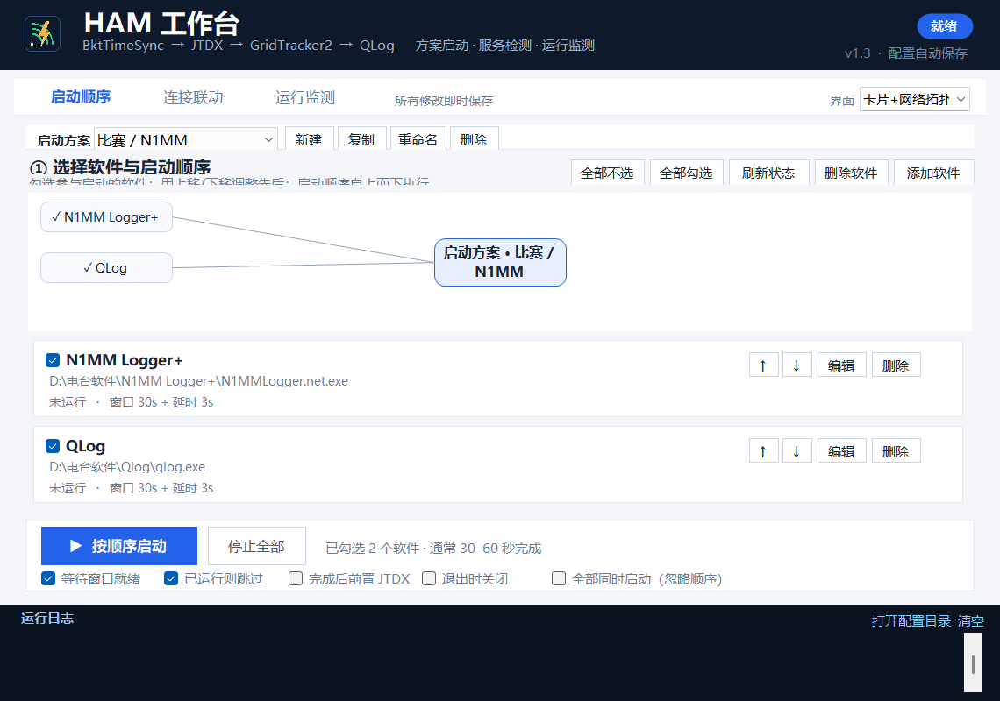
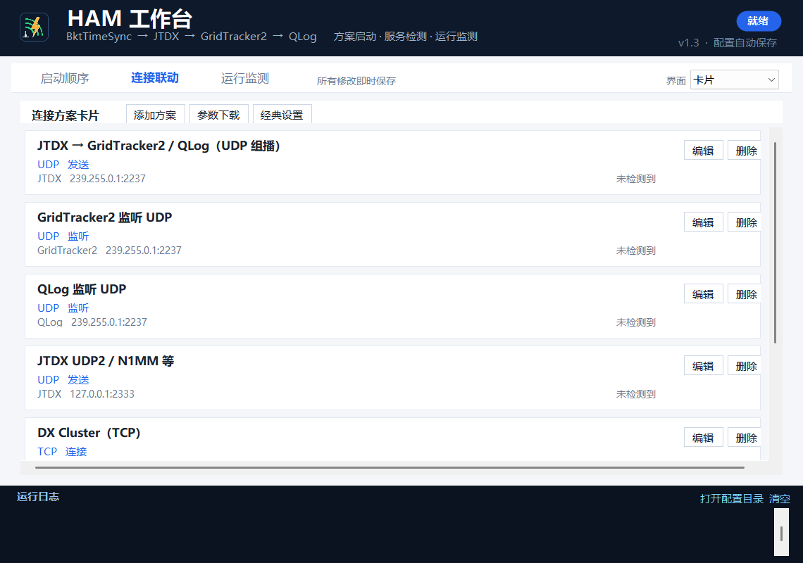

# HAM 工作台 · 使用说明（v1.3）

一个中文 Windows 小程序：用**方案**管理任意 Ham 软件的启动顺序，自动发现运行中的 Ham 软件、UDP/TCP/串口连接和 ADI 记录文件，并支持卡片/网络拓扑界面。





---

## 一、v1.3 更新内容

### 1. 名称

“HAM 启动台”正式更名为 **HAM 工作台**。

### 2. 连接联动（原 UDP 联动）

原“UDP 联动”模块升级为“**连接联动**”，支持多协议连接方案：

- 协议类型：**UDP / TCP / 串口 / 自定义（其他）**；
- 每个方案可设置：名称、匹配软件、地址、端口、方向、备注、是否启用、是否自动匹配；
- 默认内置方案：JTDX UDP 组播、GridTracker2/QLog 监听、JTDX UDP2/N1MM、DX Cluster TCP、串口 CAT 示例、自定义连接；
- 运行监测发现相关软件启动后，**自动匹配**对应连接方案，并在日志、托盘气泡、监测页提示；
- 支持 **参数下载**：把全部连接方案、已检测到的软件/端口/ADI 路径和匹配结果导出为 JSON 文件。

### 3. 三种界面风格

右上角“界面”下拉框，三个页面同时生效：

- **经典界面**：v1.2 原有布局（可编辑列表、UDP 设置等），完整保留；
- **卡片**：启动顺序 / 连接联动 / 运行监测均使用卡片列表；
- **卡片+网络拓扑**：在卡片上方增加拓扑图，直观看到软件与连接关系。

经典界面仍是默认值；选择会保存，下次启动沿用。

---

## 二、快速上手

1. 双击 `HamStartup.exe`。
2. 在“启动方案”选择/新建方案；新方案点 **添加软件**，从检测列表选 N1MM 等或浏览 exe/lnk。
3. 勾选软件、调整顺序；需要同时启动则勾选“全部同时启动（忽略顺序）”。
4. 点启动；启动完成后打开“运行监测”页，自动显示：
   - 运行中的 Ham 软件；
   - UDP 端点；
   - DX 集群 TCP 连接；
   - ADI 记录文件；
   - 自动匹配的连接方案。
5. 在“连接联动”页可查看/编辑方案、自动匹配、参数下载。

---

## 三、方案制启动

- 顶部方案下拉框：切换方案；
- **新建**：创建空方案；**复制**：复制当前方案；**重命名** / **删除**；
- 每套方案独立保存软件列表、顺序、等待时间、管理员运行等；
- **添加软件**：列出注册表/开始菜单检测到的 Ham 软件（N1MM、JTDX、WSJT-X、GridTracker2、QLog、Log4OM、MSHV、JS8Call、fldigi、SDR/CW 工具等），也可浏览任意 exe/lnk；
- **删除软件**：只从当前方案移除，不卸载。

启动顺序：

- “窗口+延时”= 最多等主窗口 N 秒 + 启动后额外等待 N 秒；
- 已运行则跳过；完成后可前置 JTDX；
- **全部同时启动**：忽略顺序，全部同时拉起。

---

## 四、连接联动（多协议）

### 1. 连接方案

经典界面中为列表，卡片界面中为卡片。每个方案包含：

| 字段 | 说明 |
|---|---|
| 名称 | 方案显示名 |
| 连接类型 | UDP / TCP / 串口 / 其他 |
| 匹配软件 | 名称/进程名关键字，如 `JTDX`、`N1MM`、`QLog` |
| 本地地址/端口 | UDP 监听/发送地址；串口填 `COM10` |
| 远端地址/端口 | TCP 目标；DX Cluster 常用 7300 |
| 方向 | 发送 / 监听 / 连接 / 串口 / 其他 |
| 自动匹配 | 是否参与自动匹配提示 |

### 2. 自动匹配

- 运行监测每 3 秒扫描；
- 对应软件启动且检测到端口/连接满足方案时，记录“已自动匹配连接方案”；
- 监测页摘要显示“已匹配连接方案 N 个”，监测页横幅/托盘气泡提示；
- 可在“连接联动”页关闭“自动匹配并提示”，或点“立即匹配”。

匹配规则：

- UDP：软件（或其子进程/daemon）存在对应本地端口；
- TCP：软件存在对应监听/连接端口，DX Cluster 端口会标记“疑似 DX 集群”；
- 串口：`COMx` 当前存在；
- 其他：匹配软件运行中。

### 3. 参数下载

“参数下载”按钮会导出 JSON，内容包含：

- 所有连接方案（协议/软件/地址/端口/方向/备注）；
- 当前检测到的软件、UDP/TCP 端点、ADI 文件；
- 每个方案的匹配结果。

适合备份、发给别人复用，或作为排障资料。

---

## 五、运行监测

- 自动发现正在运行的 Ham 软件（不要求先加入方案）；
- 列：软件、状态、PID、CPU、内存、UDP、DX 集群、ADI；
- 详情：路径、窗口标题、启动时间、UDP 端点、TCP 连接、ADI 文件；
- **卡死**：有窗口软件连续约 6 秒无响应 → 红色提示 + 日志 + 托盘气泡；
- **崩溃**：进程异常退出（退出码非 0）或退出前无响应 → “可能已崩溃”；
- 正常关闭不会误报；停止全部时暂时静音。

ADI 检测范围：JTDX/WSJT-X、Documents、桌面、下载、N1MM、各方案程序目录等，首次扫描可能需要几秒。

---

## 六、三种界面

| 风格 | 特点 |
|---|---|
| 经典界面 | 原有列表/详情/UDP 设置，适合精确编辑 |
| 卡片 | 三个页面均以卡片展示，信息更直观 |
| 卡片+网络拓扑 | 卡片上方增加拓扑图，显示软件、连接方案、服务关系 |

切换方式：右上角“界面”下拉框。默认经典界面，选择会保存。

---

## 七、UDP 配置（仍保留）

连接联动页下方保留原有 JTDX / GridTracker2 / QLog 的 UDP 设置：

- 读取当前、应用单项、一键应用推荐；
- 写前自动备份，写后回读校验；
- 推荐：JTDX `239.255.0.1:2237`、UDP2 `127.0.0.1:2333`；GridTracker2/QLog 监听 `2237` 组播；
- 写入前关闭对应软件。

---

## 八、设置与便携模式

- 优先使用 exe 同目录的 `HamStartup.settings.ini`；
- 若旧 AppData 设置可写则沿用；
- 程序目录/AppData 都不可写时回退到 `%LOCALAPPDATA%` 或临时目录；
- 日志、备份跟随设置文件；
- 日志带 `[INFO]/[STEP]/[OK]/[WARN]/[ERR]`。

受限权限（低完整性/AI 沙箱）启动时会提示以管理员身份重启；否则 QLog 等可能读不到自己的配置。

---

## 九、命令行

```text
HamStartup.exe --autostart         打开后自动开始启动
HamStartup.exe --quit-after-start  启动后退出
HamStartup.exe --config <路径>     使用指定 settings.ini
```

---

## 十、常见问题

**1. 连接方案一直“未检测到”？**
确认对应软件已运行，且端口/地址匹配；UDP 需要程序确实绑定了该端口；TCP DX 集群需要已连接。

**2. 自动匹配没有提示？**
检查“自动匹配并提示”是否勾选；查看日志中的“已自动匹配连接方案”。

**3. 参数下载后怎么用？**
JSON 可读，包含所有方案和检测结果；可用于备份或对照设置。

**4. 卡片界面不能编辑细节？**
点卡片上的“编辑”会切回经典界面并选中该项；经典界面完整保留。

**5. QLog 显示全新配置？**
见 v1.1/v1.2 的便携设置与低权限提示；在启动顺序页选中 QLog 点“桌面图标”。

---

## 十一、环境与版本

- Windows 10 / 11 64 位；.NET Framework 4.8（系统自带）。
- 单文件 exe，无需 Python / Node.js。
- v1.3，2026-11-02。
