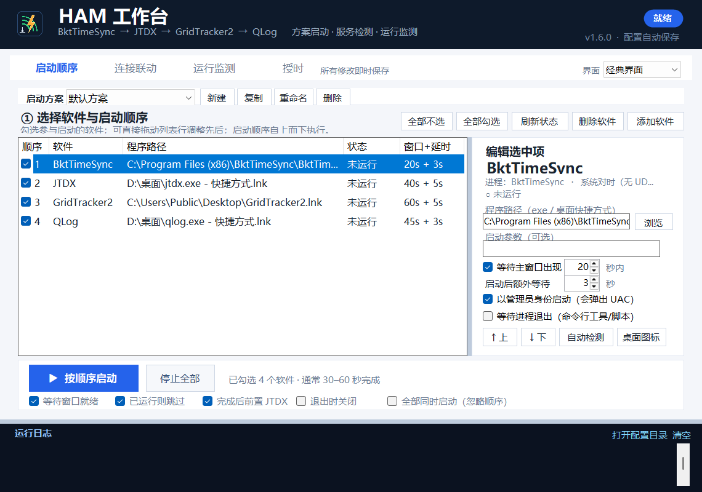
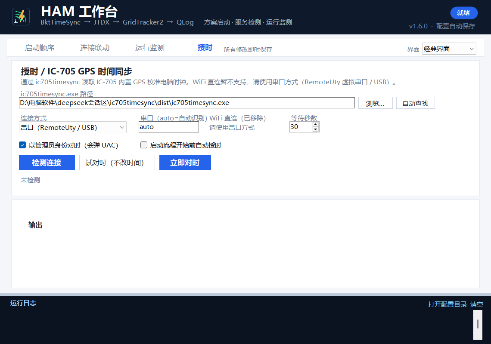

# HAM 工作台 · 使用说明（v1.6.0）

一个中文 Windows 桌面小程序：用**方案**管理 Ham 软件的启动顺序，自动发现运行中的 Ham 软件、
UDP/TCP/串口连接和 ADI 记录文件，并新增 **IC-705 GPS 授时页** 与 **“等待进程退出”** 功能。





> 版本：**v1.6.0（整合版）**，2026-11-08。
> 本版整合了 2026-11-07 夜间一系列测试版（1.4 / 1.5 / 1.5.1 / 1.5.2）的全部功能与修复。

---

## 一、本版亮点

- **整合测试版**：1.4 的“等待进程退出”、1.5 的“授时页”、1.5.1 的对时前只读检查、
  1.5.2 的串口-only 与界面加载修复，全部合并进一个正式版本。
- **新增“等待进程退出”**：命令行工具 / 脚本可以插进启动流程，按“进程结束”而不是“窗口出现”推进，
  并记录耗时与退出码。
- **新增第四个标签页“授时”**：检测连接 / 试对时 / 立即对时，支持 exe 自动查找与“启动前自动授时”。
- **只保留串口授时方式**：WiFi 直连（`transport=lan`）已移除，旧配置自动按串口处理。
- **新增命令行信息选项**：`--help`、`--version`。

---

## 二、安装与便携模式

1. 解压 `HamStartup-v1.6.0.zip` 到任意目录（例如 `D:\电台软件\HAM\`）。
2. 双击 `HamStartup.exe`。无需安装、不写注册表、不需要 Python / Node.js。
3. 设置自动保存在：
   - 优先：exe 同目录的 `HamStartup.settings.ini`（便携模式）；
   - 其次：`%APPDATA%\HamStartup\settings.ini`（沿用旧版配置）；
   - 都不可写：回退到 `%LOCALAPPDATA%` 或临时目录（重启后可能丢失）。
4. 日志与备份跟着设置文件走，位于同目录的 `logs\`、`backups\`。

系统要求：Windows 10 / 11 64 位，.NET Framework 4.8（系统自带）。
程序未签名，SmartScreen 提示时选择“更多信息 → 仍要运行”。

> 如果程序提示“受限权限（低完整性）”，建议关闭后从资源管理器正常双击；
> 否则 QLog 等软件可能读不到自己的配置。

---

## 三、界面总览

顶部四个标签页：

| 标签页 | 用途 |
|---|---|
| **启动顺序** | 管理方案、软件列表、启动顺序、每项等待方式 |
| **连接联动** | UDP / TCP / 串口 / 自定义连接方案、自动匹配、参数下载 |
| **运行监测** | 运行中的 Ham 软件、PID/CPU/内存、UDP/DX/ADI、卡死崩溃提示 |
| **授时** | IC-705 GPS 授时（新版） |

右上角“界面”下拉框可切换 **经典界面 / 卡片 / 卡片+网络拓扑**，选择会自动保存。

---

## 四、启动方案与启动顺序

### 1. 方案

- 顶部“启动方案”下拉框切换；**新建 / 复制 / 重命名 / 删除** 方案；
- 每套方案独立保存软件列表、顺序、等待时间、管理员运行等；
- **添加软件**：从检测到的 Ham 软件中选择，或浏览任意 `.exe` / 桌面 `.lnk`；
- **删除软件**：只从当前方案移除，不卸载、不删配置。

### 2. 启动顺序

- 列表从上到下执行，可直接**拖动行**调整顺序；“窗口+延时”列显示每项的等待方式；
- 每项可设置：程序路径、启动参数、是否等待窗口、等待秒数、额外延时、以管理员身份启动；
- 已运行则跳过（可在下方选项关闭）；
- 完成后可自动前置 JTDX。

### 3. 等待进程退出（命令行工具 / 脚本）

适合 `ic705timesync.exe`、批处理、PowerShell 脚本等**没有主窗口**的程序：

1. 选中该项，勾选 **“等待进程退出（命令行工具/脚本）”**；
2. 启动器会等该进程真正结束，再执行下一步；
3. 运行日志会记录：`进程已退出（1.4 秒，退出码 3）`；
4. 等待秒数作为超时上限（默认 60 秒），超时只告警并继续。

**“全部同时启动”模式**下，带“等待进程退出”的步骤会先按顺序执行完，再并行启动其余软件，
保证“先授时、后开 JTDX”的顺序不被并行模式打乱。

### 4. 全部同时启动

勾选底部 **“全部同时启动（忽略顺序）”**，启动按钮会变成“▶ 全部同时启动”。
适合不关心先后、希望尽快全部拉起的场景；需要先完成的命令行步骤仍会先跑完。

---

## 五、授时页（IC-705 GPS）

### 1. 前提

- 已安装并配置 **RemoteUty**（虚拟串口）或用 **USB 线**连接 IC-705；
- 已单独下载 `ic705timesync.exe`（本压缩包**不包含**它），放到固定目录，
  例如 `D:\电台软件\ic705timesync\`。

> **WiFi 直连暂不支持**：独立版 `ic705timesync.exe` 无法加载 `icom-lan` 模块。
> 页面上的“电台 IP”输入框已改为说明文字；连接方式只保留串口。

### 2. 设置

1. **ic705timesync.exe 路径**：点“浏览…”选择，或点“自动查找”；
   自动查找会依次搜索启动器目录、`..\ic705timesync\dist\`、
   `D:\电脑软件\deepseek会话区\ic705timesync\dist\` 等位置。
2. **连接方式**：串口（RemoteUty / USB）。
3. **串口**：填 `auto` 自动识别，或具体端口如 `COM20`。
4. **等待秒数**：调用超时上限（默认 30 秒）。
5. **以管理员身份对时**：勾选后“立即对时”会弹 UAC。建议保持勾选（改系统时间需要管理员权限）。

### 3. 三个操作

| 按钮 | 作用 | 是否改时间 |
|---|---|---|
| **检测连接** | 只读 GPS 时间与电脑时钟偏差 | 否 |
| **试对时（不改时间）** | `sync --dry-run`，只计算不写入 | 否 |
| **立即对时** | 先做一次只读检查，通过后真正校准系统时间 | 是 |

- 点“立即对时”时，程序会**先执行一次只读检查**：链路不通会直接显示可读原因，
  不会先弹 UAC 再失败。
- 所有结果同时显示在状态栏和下方“输出”框，并写入运行日志；
  “上次结果”会保存到配置，重启后仍能看到。
- 执行期间三个按钮与输入项会暂时禁用，避免重复点击。

### 4. 启动流程开始前自动授时

勾选 **“启动流程开始前自动授时”** 后：

- “按顺序启动”和“全部同时启动”两种模式都会在启动软件前先执行一次对时；
- 授时失败只在日志中告警，**不会阻断**软件启动。

### 5. 已知限制

- 管理员模式（`runas`）下无法捕获子进程输出：失败时可能只有退出码或“用户取消了管理员授权”；
  遇到这种情况请先点“检测连接”用普通权限查看详细原因。
- 串口是独占的：JTDX 打开后可能无法再授时，请先对时再开 JTDX，或把授时作为启动流程第一步。

---

## 六、连接联动与运行监测（简述）

- **连接联动**：UDP / TCP / 串口 / 自定义方案；可添加、编辑、启用/禁用；
  运行监测发现软件启动后自动匹配，并可在日志、托盘、监测页提示；
  “参数下载”可导出全部方案与检测结果为 JSON。
- **运行监测**：自动发现运行中的 Ham 软件，显示 PID、CPU、内存、UDP 端点、DX 集群、ADI 记录文件；
  窗口连续约 6 秒无响应或异常退出时提示卡死/崩溃。
- 详细说明见仓库 README 与历史版本的《使用说明》。

---

## 七、命令行

```text
HamStartup.exe --help              显示帮助（-h / -? 亦可）
HamStartup.exe --version           显示版本号（-v 亦可）
HamStartup.exe --autostart         打开后自动开始启动流程
HamStartup.exe --quit-after-start  启动流程结束后退出
HamStartup.exe --config <路径>     使用指定的 settings.ini
HamStartup.exe --no-elevate        受限权限时不提示“以管理员身份重启”
```

从命令行启动时信息输出到控制台；双击启动时以弹窗显示。

---

## 八、常见问题（FAQ）

**1. 授时页提示“找不到 ic705timesync.exe”？**
点“浏览…”选择程序路径，或把 `ic705timesync.exe` 放到 `HamStartup.exe` 同一目录；
也可点“自动查找”让它搜索常见目录。

**2. 为什么没有 WiFi / 电台 IP 选项了？**
v1.5.2 起已移除 WiFi 直连：独立版 `ic705timesync.exe` 无法加载 `icom-lan` 模块。
请使用串口方式（RemoteUty 虚拟串口或 USB 线）。

**3. 检测连接失败，提示串口被占用？**
虚拟串口是独占的：先关闭 JTDX，或先断开 JTDX 的 CAT/音频串口，再点“检测连接”。
也可以先打开 RemoteUty 并连上电台，确认虚拟串口已出现。

**4. 立即对时弹了 UAC，但最后失败了？**
先点“检测连接”（不需要管理员权限）确认链路与 GPS 是否正常；
管理员模式下程序无法捕获子进程输出，失败原因以退出码/系统提示为准。

**5. 授时失败会不会影响启动软件？**
不会。自动授时失败只写日志告警，启动流程继续。

**6. 勾了“等待进程退出”，为什么日志显示超时？**
等待秒数是超时上限，程序超时后会继续下一步。命令行工具请把等待秒数设大一些（例如 30–60 秒）。

**7. 旧版本的配置还能用吗？**
可以。1.3.x / 1.4 / 1.5.x 的 `HamStartup.settings.ini` 直接沿用；
旧的 `transport=lan` 会自动按串口处理，保存时写回 `serial`。

**8. QLog 显示全新配置？**
用桌面 `.lnk` 快捷方式启动 QLog，或从资源管理器正常双击启动器（不要用受限权限运行），
详见 README 的便携设置与低权限提示。

**9. 卡片界面不能编辑细节？**
点卡片上的“编辑”会切回经典界面并选中该项；经典界面保留全部编辑能力。

---

## 九、升级与兼容

- 从 1.5.x / 1.4 升级：直接替换 `HamStartup.exe` 即可，配置自动沿用；
- 从 1.3.x 升级：`[timesync]` 段缺失时自动使用默认值（串口、`auto`、30 秒、管理员对时）；
- 本版 `AssemblyVersion` / `AssemblyFileVersion` 均为 `1.6.0.0`。

---

## 十、版本与环境

- 版本：**v1.6.0（整合版）**，2026-11-08；
- 环境：Windows 10 / 11 64 位，.NET Framework 4.8（系统自带）；
- 单文件 exe，无需 Python / Node.js；
- 授时依赖外部 `ic705timesync.exe`，需单独准备。
